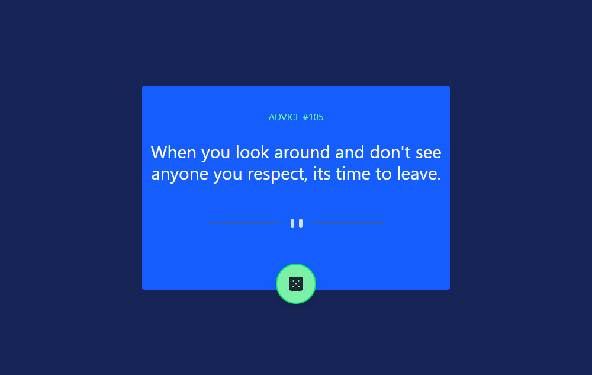
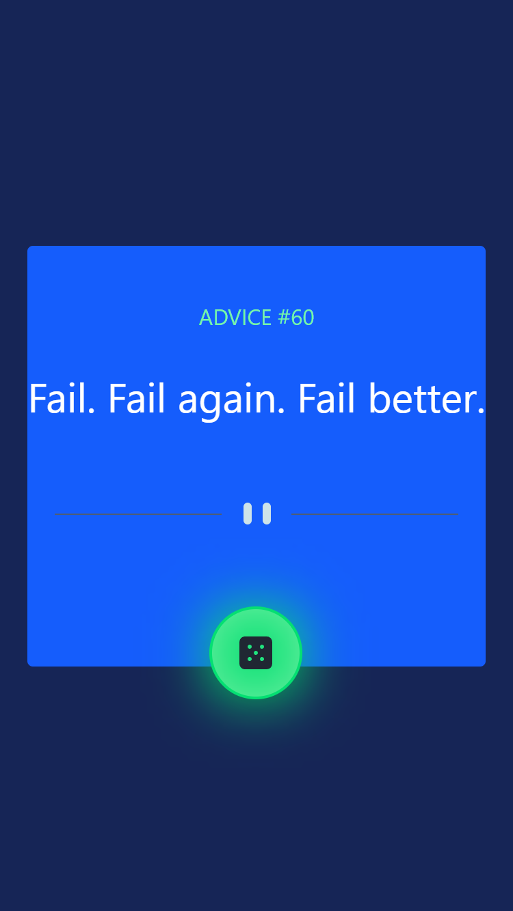

# Frontend Mentor - Advice generator app solution

This is a solution to the [Advice generator app challenge on Frontend Mentor](https://www.frontendmentor.io/challenges/advice-generator-app-QdUG-13db). Frontend Mentor challenges help you improve your coding skills by building realistic projects.

## Table of contents

- [Overview](#overview)
  - [The challenge](#the-challenge)
  - [Screenshot](#screenshot)
  - [Links](#links)
- [My process](#my-process)
  - [Built with](#built-with)
  - [What I learned](#what-i-learned)
  - [Continued development](#continued-development)
  - [Useful resources](#useful-resources)
  - [AI Collaboration](#ai-collaboration)
- [Author](#author)
- [Acknowledgments](#acknowledgments)

## Overview

### The challenge

Users should be able to:

- View the optimal layout for the app depending on their device's screen size
- See hover states for all interactive elements on the page
- Generate a new piece of advice by clicking the dice icon

### Screenshot

### Links

- Solution URL: [Add solution URL here](https://github.com/dd-boy22/advice-generator-app.git)
- Live Site URL: [Add live site URL here](https://advice-generator-app-iota-lemon.vercel.app/)

## My process

### Built with

- JSX
- Tailwind CSS
- Javascript(ES6+)
- React Hooks (useState and useEffect)
- Flexbox
- Vite
- Mobile-first workflow
- Fetch API
- Advice Slip API
- [React](https://reactjs.org/) - JS library

### What I learned

This project helped me understand how to fetch data from an external API and display it dynamically in a React application.

I improved my understanding of useState and how updating state causes React to re-render a component when necessary. I also learned how useEffect can be used to fetch the initial advice when the component mounts without repeating the request after every state update.

Another important lesson was understanding how event handlers work alongside state. The dice button calls the same fetch function to request new advice, while the state updates allow React to display the new advice and its ID without reloading the page.

I also practised building a responsive interface with Tailwind CSS, including implementing the UI layout and hover effects independently.

### Continued development

I want to continue improving my understanding of React Hooks, particularly useEffect, state management, and how components behave when state changes.

I also plan to practise more API integration, including handling loading states, errors, and asynchronous operations. As I continue building projects, I want to strengthen my React fundamentals and become more confident in writing and debugging my own code.

### Useful resources

- React Documentation - Helped me understand state, component rendering, and the useEffect Hook.
- Tailwind CSS Documentation - Useful for learning Tailwind utility classes and building responsive layouts.
- Advice Slip API - Provided the random advice and advice IDs used in this project.

### AI Collaboration

I used ChatGPT as a learning assistant during this project to clarify React concepts, understand the relationship between state updates and component rendering, and troubleshoot issues encountered while working with useEffect.

The assistance focused on explanations and debugging rather than having the project built for me. I worked on the UI design, responsive layout, styling, and hover effects independently.

Using AI as a learning resource helped me understand the reasoning behind my code and improve my ability to solve problems independently.

## Author

- Frontend Mentor - [@dd-boy22](https://www.frontendmentor.io/profile/dd-boy22)
- GitHub - [@dd-boy22](https://github.com/dd-boy22
)

## Acknowledgments

Thanks to Frontend Mentor for providing the challenge and starter files, and to the Advice Slip API for making the advice data available for this project. I also used the official React and Tailwind CSS documentation as learning resources during development.
